# ITAP系統架構

核對日期：2026-10-16。需求以`AGENTS.md`為準，實作以目前工作區原始碼為準。實線只表示程式路徑存在，不代表已通過實機驗證。本圖不修改或新增架構決策。

```mermaid
flowchart LR
    subgraph Remote["感測端"]
        direction TB
        subgraph Watch["手錶：ble_sensor_hr"]
            WP["BMH08002-4<br/>PPG模組"]
            WI["LSM6DS3<br/>IMU"]
            WU["SH1106 OLED＋按鍵<br/>提示文件原列SSD1306"]
            MCU["N76E003<br/>板上心率計算／組封包"]
            BM["BM7701<br/>Peripheral／GATT server"]
        end
        subgraph Strap["綁帶：替代方案／待驗證"]
            MAX["MAX30103<br/>無IMU"]
            EP["ePy Lite<br/>板上算心率／內建BLE"]
        end
        SIM["remote_sensor_simulator<br/>Flutter Android／Kotlin GATT server<br/>僅測試用"]
    end

    subgraph Hub["HUB8735 Ultra"]
        direction LR
        subgraph Interface["介面層"]
            CENTRAL["BLE Central＋notificationCB<br/>胸帶BLE_sensor_ITAP＋手錶BLE_watch_ITAP<br/>各自Auto／Manual"]
            QRX["bleRxFrameQueue"]
            LP["本地BMH08002-4<br/>UART3 38400／D6 TX、D5 RX<br/>EN=D7"]
            LI["本地LSM6DS3<br/>Wire1／D0 SDA、D1 SCL／0x6B"]
            LOCAL["localSensorPoll<br/>於analysisTask執行<br/>PPG／IMU各自與BLE二選一"]
            KEY["3顆按鍵<br/>D8上／D9下／D10 OK"]
            SERIAL["Serial<br/>除錯／手動指令／auto／src"]
        end
        subgraph Tasks["task層：5個應用task；Queue為節點"]
            BLE["BLETask<br/>來源篩選／解析01–04"]
            QS["ppgSensorQueue<br/>accSensorQueue<br/>gyroSensorQueue"]
            ANALYSIS["analysisTask<br/>有效HR→HRmax→穩定Zone→目標BPM<br/>不操作播放"]
            QT["targetBpmResultQueue"]
            CONTROL["controlTask<br/>Enjoy／Train自動⇄Manual<br/>手動優先／選曲／失敗跳過"]
            QA["audioCmdQueue"]
            AUDIO["audioTask<br/>唯一SD與MAX98357擁有者<br/>Stopped才分析；Play取消分析"]
            QE["audioPlaybackEventQueue"]
            UI["UITask<br/>Mode／Play-Pause／Stop／Volume<br/>BPM Analysis／Songs／Source"]
            QC["uiCmdQueue"]
            QU["uiUpdateQueue"]
            QAN["analysisCmdQueue"]
            QTX["bleTxQueue<br/>已建立；無生產者／消費者"]
        end
        subgraph Storage["儲存與輸出層"]
            SD[("SD根目錄<br/>NNN.mp3／music_library.json<br/>YAMNet模型：SDK設定由SD載入")]
            LIB["musicLibrary：共享RAM<br/>file／bpm／genre／size／modified<br/>最多1024首；controlTask／UITask唯讀"]
            BPM["MusicBpmAnalyzer<br/>Helix→mono PCM→MiniBPM<br/>最多60s"]
            NPU["MusicGenreClassifier＋NPU<br/>Helix→16kHz mono PCM→YAMNet<br/>已接入掃描／實機待驗證"]
            AMP["雙MAX98357<br/>共用EN：D15<br/>D22為MCLK，不可佔用"]
        end
        REQ["已確認需求／尚缺整合<br/>自動偵測新檔或替換→延後分析<br/>使用者偏好曲風→BPM＋曲風選曲<br/>完整分析成功才加入自動選曲"]
        PROPOSAL["提案／待核定<br/>YAMNet＋自訂分類頭<br/>多片段取樣／曲風類別集合"]
    end

    SPK["喇叭"]
    OLED["SH1106 128×64 OLED<br/>Wire／D3 SDA、D4 SCL／0x3C"]

    WP -->|"PPG／UART0 38400；約35.8Hz實測"| MCU
    WI -->|"ACC＋GYRO／I2C0 0x6B；上報1Hz"| MCU
    WU -->|"按鍵／GPIO事件"| MCU
    MCU -->|"顯示資料／I2C0 0x3C"| WU
    MCU -->|"PPG 20B／IMU 21B；UART1 115200＋BCI"| BM
    MAX -.->|"原始PPG／I2C；頻率待驗證"| EP
    BM -->|"BLE notify FFF1優先／D002備援；依感測上報"| CENTRAL
    EP -.->|"HR／BLE notify；相容性待驗證"| CENTRAL
    SIM -.->|"回放PPG／IMU；BLE notify FFF1；測試時序"| CENTRAL
    CENTRAL -->|"原始frame＋hub_rx_time_ms／callback逐包"| QRX
    QRX -->|"BleFrameElement／每100ms迴圈取一筆"| BLE
    LP -->|"PPG／UART3；依模組到包"| LOCAL
    LI -->|"ACC／GYRO／Wire1；讀取1Hz"| LOCAL
    LOCAL -->|"Ppg／Acc／GyroElement／隨取樣入列"| QS
    BLE -->|"Ppg／Acc／GyroElement／依notify入列"| QS
    QS -->|"PPG排空；ACC／GYRO各一筆／20ms迴圈"| ANALYSIS
    ANALYSIS -->|"TargetBpmResult：BPM＋Zone／1Hz計算、變化才覆寫"| QT
    QT -->|"最新BPM＋Zone／100ms迴圈排空"| CONTROL
    KEY -->|"按鍵／GPIO低有效；10ms輪詢"| UI
    UI -->|"UiCommandElement／操作事件"| QC
    QC -->|"模式／播放／音量／分析／來源／100ms迴圈"| CONTROL
    SERIAL -->|"play／stop／pause／resume／volume／auto／src；直接讀取"| CONTROL
    CONTROL -->|"AudioCmdElement：Play filename等／控制事件"| QA
    QA -->|"播放／分析／取消命令；活動時非阻塞、閒置時等待"| AUDIO
    AUDIO -->|"Finished／Failed＋songIndex／自動播放事件"| QE
    QE -->|"播畢／失敗／100ms迴圈排空"| CONTROL
    CONTROL -->|"SetPpgSource／SetMotionSource／來源切換事件"| QAN
    QAN -->|"AnalysisCmdElement／20ms迴圈排空"| ANALYSIS
    BLE -->|"感測值／連線狀態；事件＋連線1Hz"| QU
    LOCAL -->|"本地感測值／隨取樣"| QU
    CONTROL -->|"模式／分析請求狀態／控制事件"| QU
    AUDIO -->|"AudioState／分析進度與成敗／狀態事件"| QU
    QU -->|"UiUpdateElement／10ms迴圈排空"| UI
    UI -->|"畫面／Wire I2C；最短50ms重繪、2s全刷"| OLED
    SD -->|"MP3／JSON／模型檔；FatFS，按需讀取"| AUDIO
    AUDIO -->|"更新JSON：tmp→備份bak→換入json／每次儲存"| SD
    AUDIO -->|"載入／更新metadata；musicLibraryReady與busy旗標"| LIB
    LIB -->|"metadata／選曲時讀RAM，不碰SD"| CONTROL
    LIB -->|"檔名＋BPM／Songs選單讀RAM"| UI
    AUDIO -->|"MP3／停止後逐段解碼"| BPM
    BPM -->|"BPM／完成或失敗"| AUDIO
    AUDIO -->|"MP3／停止後、BPM階段結束再分類"| NPU
    NPU -->|"genre／Unknown／失敗；每首完成"| AUDIO
    AUDIO -->|"播放PCM／I2S；依MP3取樣率"| AMP
    AMP -->|"功率音訊／喇叭線"| SPK
    SD -.->|"新檔／替換事件；尚無自動監測"| REQ
    REQ -.->|"停止後執行待分析工作；待整合"| AUDIO
    REQ -.->|"偏好曲風＋完整分析資格；待整合"| CONTROL
    PROPOSAL -.->|"候選模型／分類策略；非目前SDK流程"| NPU

    classDef task fill:#e8f2ff,stroke:#2866a1,color:#12334e
    classDef queue fill:#f4f8fc,stroke:#7890a5,color:#12334e
    classDef requirement fill:#fff4d6,stroke:#a66b00,stroke-dasharray:7 4,color:#694400
    classDef proposal fill:#f3f3f3,stroke:#888,stroke-dasharray:2 5,color:#555
    classDef test fill:#edf8ff,stroke:#4883a8,stroke-dasharray:7 4,color:#234b65
    class BLE,ANALYSIS,CONTROL,AUDIO,UI task
    class QRX,QS,QT,QA,QE,QC,QU,QAN,QTX queue
    class REQ requirement
    class MAX,EP,PROPOSAL proposal
    class SIM test
    linkStyle 5,7,48 stroke:#888,stroke-dasharray:2 5
    linkStyle 8 stroke:#4883a8,stroke-dasharray:7 4
    linkStyle 45,46,47 stroke:#a66b00,stroke-dasharray:7 4
```

## 圖例與閱讀方式

- **實線**：目前原始碼已有路徑；藍底為5個應用FreeRTOS task，淺底為Queue。SDK的BLE與NN內部執行緒不計入這5個task。
- **琥珀色虛線**：已確認需求但尚未整合。曲風推論及儲存已有程式，偏好設定與曲風選曲仍缺；自動新檔／替換偵測及播放中延後分析也缺。
- **灰色點線**：提案或待驗證的替代方案；綁帶依需求列入圖中，但目前提供的ePy Lite文件只有硬體方案比較，不能證明端到端韌體已完成。自訂分類頭提案亦不等於目前SDK YAMNet實作。
- **藍色虛線**：測試模擬器邊界，與功能完成度分開標示；模擬器已有實作。產品手機App不在本圖範圍。
- 同一節點內合併3條感測Queue以維持單圖可讀性；其資料型別與方向分別列於下表。`localSensorPoll`是`analysisTask`內的函式，不是第6個task。

## Queue方向逐條核對

| Queue | 實際生產者→消費者 | 資料與使用情況 |
| --- | --- | --- |
| `bleRxFrameQueue` | BLE堆疊的`notificationCB`→`BLETask` | 原始frame、長度、主機接收時間；非`BLETask`自行生產 |
| `ppgSensorQueue` | `BLETask`或`analysisTask`呼叫的`localSensorPoll`→`analysisTask` | `PpgSensorElement`；依目前PPG來源二選一 |
| `accSensorQueue` | `BLETask`或`analysisTask`呼叫的`localSensorPoll`→`analysisTask` | `AccElement`；目前只接收與記錄，不參與目標BPM公式 |
| `gyroSensorQueue` | `BLETask`或`analysisTask`呼叫的`localSensorPoll`→`analysisTask` | `GyroElement`；與ACC共用IMU來源選擇 |
| `targetBpmResultQueue` | `analysisTask`→`controlTask` | 單槽覆寫`TargetBpmResult`，含目標BPM與Zone |
| `audioCmdQueue` | `controlTask`→`audioTask` | 播放、暫停、停止、恢復、音量、分析及取消 |
| `audioPlaybackEventQueue` | `audioTask`→`controlTask` | 自動播放的`Finished`／`Failed`及曲目索引；不是分析完成通知 |
| `uiUpdateQueue` | `BLETask`、`controlTask`、`audioTask`、`analysisTask`內的本地感測函式→`UITask` | 感測、連線、模式、播放及分析狀態；目前`analysisTask`沒有另送目標BPM更新 |
| `uiCmdQueue` | `UITask`→`controlTask` | OLED操作；序列埠由`controlTask`直接處理，不經此Queue |
| `analysisCmdQueue` | `controlTask`→`analysisTask` | 執行期切換PPG／IMU來源 |
| `bleTxQueue` | 無→無 | 宣告、建立及初始化檢查存在；沒有任何send／receive，不能畫成有效下傳通路 |

核對來源為`globalData.h/.cpp`、`embedded_loudspeaker.ino`及上述task與`localSensor.cpp`的Queue呼叫。曲庫經`audioTask`載入共享RAM，`controlTask`與`UITask`不讀SD；分析成敗直接送`uiUpdateQueue`，`controlTask`透過共享busy旗標延後自動選曲，沒有專用分析結果Queue。

## 行為與資料契約

### 感測與目標BPM

`analysisTask`只接受`status==2`且HR非0的PPG；最新有效樣本保留15s，逾時或收到無效資料就停止更新目標並清除候選Zone倒數。首次有效心率立即設定Zone；後續需越過舊Zone邊界達2% HRmax並維持10s才換區。HRmax為`206.9−0.67×age`四捨五入；目前`setup()`固定年齡25。目標每1s計算，只有BPM或Zone變化才覆寫結果，上升每次最多+5、下降立即；Zone 1線性映射至60–80、Zone 2–3用心率、Zone 4–5用心率×0.75。

尚無有效目標時自動播放等待，手動播放可用；失聯後`controlTask`保留最後目標。手動`play/pause/stop/resume`進入Manual，感測更新不會解除；明確`auto`或Mode選Enjoy／Train才恢復自動。Train不使用心率目標，改依內建課表的段落Zone選曲，見`hub8735/HRMAX_MUSIC_FLOW.md`。

來源為**執行期**選擇：預設PPG與IMU均為`Chest`，可由OLED的Source或`src ppg|motion chest|watch|local`各自切換。`analysisTask`啟停本地感測並清除舊Queue；初始化失敗保留原來源。BLE同時依來源篩掉不選用的frame。`Chest`／`Watch`是協定代碼，不能直接當成實體胸帶／手錶型態；`ble_sensor_hr`（手錶）送source=1，`ble_sensor`（胸帶）送source=0。

HUB同時連兩台：以廣播名稱`BLE_sensor_ITAP`（胸帶）、`BLE_watch_ITAP`（手錶）分辨，frame仍依msgType高4bit分來源。每台各自Auto／Manual：Auto未連上時每3s掃描2s重試，連上後一旦斷線即轉Manual；Manual只在OLED的BLE選單按Connect後掃描3s、最多3次。OLED BLE選單可Connect／Disconnect（Disconnect同時轉Manual）與切換Auto／Manual；狀態列顯示`C:`／`W:`連線狀態。Standby時兩條都斷，喚醒後Auto的立即重連。需使用`external/libraries/BLE`的修補版函式庫（GATT client只註冊一次）。

### 播放、曲庫與分析

目前選曲只看BPM：首次／Zone切換先找目標±5%內下一首，沒有則找最近BPM；同Zone內只更新目標，等歌曲播畢再選。自然播畢若沒有符合曲目，**重播原曲**，不一律改成最近BPM。失敗曲目加入遮罩跳過，全部候選失敗就不再啟播。BPM=0不參加自動選曲，但可由Songs手動播放。

`audioTask`開機載入`music_library.json`，完成後以`musicLibraryReady`解除控制端等待。條目含檔名、BPM、曲風、檔案大小與FAT日期時間，最多1024首。寫入順序為先寫`music_library.tmp`、舊JSON改名`music_library.bak`、tmp換入JSON；成功後清除bak，載入時可回復可用備份，不能把bak理解成永久保留的歷史版本。`NNN.mp3`為目前SD範例命名；掃描接受根目錄其他合法`.mp3`檔名。

目前掃描由OLED的BPM Analysis觸發，`controlTask`轉成音訊命令。**播放或暫停中請求會被拒絕並回報Cancelled，沒有排隊等停止**；只有Stopped才分析。掃描期間Play會取消工作，已存結果保留。Helix解碼成單聲道PCM後以MiniBPM分析最多60s，隨後進入曲風階段；單曲任一階段失敗會計失敗但繼續其他曲目。完成摘要走`uiUpdateQueue`。

曲風路徑已有實作：`MusicGenreClassifier`解碼最多15s、轉16kHz單聲道PCM，經`PcmArray`／`StreamIO`送SDK `NNAudioClassification`與YAMNet，彙總211–260類曲風分數，回寫`genre`；信心不足用`Unknown`，推論失敗留待重試。這是目前程式路徑，模型由SD載入仍依賴SDK建置設定與實機驗證；不宣稱分類準確率已驗證。

新檔、未知BPM／曲風、缺檔案身分或大小／時間改變，會在**使用者啟動掃描時**排入工作；替換時清除舊BPM與曲風。尚無背景目錄監測。現況在BPM成功時就儲存，即使後續曲風失敗，BPM仍可能可供自動選曲；尚未符合「完整分析成功後才加入」的需求。Reanalyze all也能重跑未變更曲目，與已確認的只在新增／替換時分析規則有落差。

### BLE空中格式

`sensor_time_ms 4B | msgType 1B | payload`，多位元組Big-endian；payload以`sequence 4B`開頭。`01`為PPG 20B、`02`為ACC＋GYRO 21B、`03`為ACC 15B、`04`為GYRO 15B，`00`保留且主機忽略。主機另記`hub_rx_time_ms`，不能把兩個不同裝置時鐘直接相減。程式把msgType高4bit視為source、低4bit視為類型。

目前先探索`FFF0`服務、`FFF1` notify、選用`FFF2` write；失敗再嘗試`524CACC0-3C17-D293-8E48-14FE2E4DA212`服務、`D002` notify、`D001` write。兩組為備選服務，不是UUID別名。write characteristic雖會被探索，應用下傳通路尚未使用。21B的`02`要求ATT MTU至少24；目前`BLETask`未見明確MTU協商呼叫，仍需驗證堆疊的實際協商結果。BM7701在其他central的25B notify實測不能證明本連線已滿足MTU。

手錶PPG原始UART實測約35.8Hz，但板上心率以不重疊10s週期更新、第一週期暖機HR=0；PPG notify取決於送包狀態與UART握手，不將10s心率更新誤標成固定notify週期。IMU上報1Hz；本地IMU讀取亦為1Hz。

## 文件矛盾的採用結論

| 項目 | 本圖採用 | 依據與差異 |
| --- | --- | --- |
| GATT | FFF0／FFF1／FFF2優先，524CACC0…／D002／D001備援 | `BLETask.cpp::UART_UUID_SETS`；快速參考只列後者，N76文件列前者；不採FFF0為write的錯誤說法 |
| 廣播名稱 | 胸帶`BLE_sensor_ITAP`、手錶`BLE_watch_ITAP` | `BLETask.h::CHEST_NAME／WATCH_NAME`；手錶對應`ble_sensor_hr/source/main.c::BM_NAME` |
| msgType | 01 PPG／02合併IMU／03 ACC／04 GYRO | `BLETask.cpp`及`ble_sensor_hr`；N76協定文件仍寫舊版02 ACC／03 GYRO，僅採其FFF0服務描述，不採其舊編號與MTU結論 |
| 功放 | 雙MAX98357；共用EN D15（左片直接、右片串200k） | `audioTask.h`與`setup()`；提示與記憶的D2為舊接法，現在`UITask`用D2讀電池；D22仍保留I2S MCLK |
| 手錶OLED／IMU | SH1106、I2C 0x3C／LSM6DS3 0x6B | `ble_sensor_hr/source/main.c`；提示SSD1306、舊協定0x6A不採用；實際焊接型號仍待確認 |
| 感測來源 | 執行期各自選PPG／IMU | `analysisTask.cpp`、`localSensor.*`、`ControlTask.cpp`；不是編譯期二選一 |
| 樣本新鮮度 | 15s | `analysisTask.cpp`；HRMAX文件的6s已落後 |
| BPM選單／NPU | 掃描已含BPM與曲風階段 | `audioTask.cpp::advanceBpmScan`、`music_genre_classifier.*`；提示、記憶、HRMAX文件的「只跑BPM」及YAMNET文件的「未實作」已落後 |
| 播放中分析請求 | 拒絕／Cancelled | `audioTask.cpp::handleAudioCommand`；HRMAX文件寫排隊，與目前實作不同；自動延後分析仍是待完成需求 |
| 概念DFD | 僅沿用命名與概念 | 不以DFD的曲風選曲、分析回報方向取代原始碼或`AGENTS.md`；核定需求仍保留並標示落差 |

## 待確認事項

1. **綁帶是否為本階段交付範圍？**BM7701是已確認正式目標；ePy Lite＋MAX30103目前僅見替代方案資料。建議保留為候選感測端，正式支援前驗證心率產生、廣播名稱與frame相容性，不視為已核定替代BM7701。
2. **曲風選項與模型分類如何對應？**偏好曲風選曲需求已確認，但SDK目前輸出50種曲風，提案另有自訂分類頭。建議先確認使用者可選的曲風集合，再決定是否沿用SDK類別或採提案；本圖不代為核定。
3. **雙功放與手錶OLED的實際接線是否已跟上程式？**功放已確認改為D15單支EN（見`firmware/hub8735-ultra/pinset.md`）；手錶OLED建議以SH1106為本次程式基準，對照板上接線後再更新硬體文件，避免依舊提示接D2。
4. **新檔流程與重分析入口如何對齊既定規則？**自動偵測、播放中延後處理與分析成功資格已有需求；目前手動Reanalyze all可能重跑未替換曲目。建議後續實作直接對齊`AGENTS.md`；若要保留未變更曲目的強制重分析，須另確認例外範圍。
5. **實機驗證仍缺哪些證據？**UI完整韌體編譯／燒錄、`ble_sensor_hr`的743B XRAM餘裕與`.XINIT`修正重燒後結果、HUB解析01–04及MTU、YAMNet模型載入／記憶體／推論品質，均不能由原始碼存在推定完成。建議分別保留測試紀錄；本次只做文件與資料流核對。

## 核對入口

- 需求：[AGENTS.md](../AGENTS.md)；既有事實：[MEMORY.md](../.agents/MEMORY.md)。其中落後資訊依上表處理，未在本次改寫既有文件。
- 韌體：[embedded_loudspeaker](../firmware/hub8735-ultra/application/embedded_loudspeaker/)的`embedded_loudspeaker.ino`、`globalData.h/.cpp`、`BLETask.h/.cpp`、`analysisTask.cpp`、`ControlTask.cpp`、`audioTask.h/.cpp`、`UITask.cpp`、`localSensor.h/.cpp`、`music_library.h/.cpp`、`music_bpm_analyzer.h/.cpp`、`music_genre_classifier.h/.cpp`及`song_catalog.h`。
- 公式參考：[target_bpm.c](../firmware/hub8735-ultra/target_bpm.c)、[target_bpm.h](../firmware/hub8735-ultra/target_bpm.h)；目前`analysisTask.cpp`內有對應實作，不畫成另一個task。
- 感測端：[ble_sensor_hr/source/main.c](../firmware/n76e003/application/ble_sensor_hr/source/main.c)、[BLE_PROTOCOL_QUICKREF.md](remote_sensor/BLE_PROTOCOL_QUICKREF.md)、[ble-notify-data-format.md](../firmware/n76e003/ble-notify-data-format.md)、[BM7701-00-1_SENSOR_PLAN.md](remote_sensor/BM7701-00-1_SENSOR_PLAN.md)。
- 概念與方案：[DFD.md](hub8735/DFD.md)、[HRMAX_MUSIC_FLOW.md](hub8735/HRMAX_MUSIC_FLOW.md)、[YAMNET_GENRE.md](hub8735/YAMNET_GENRE.md)、[ePy Lite比較](ePy_Lite/problems.md)。
