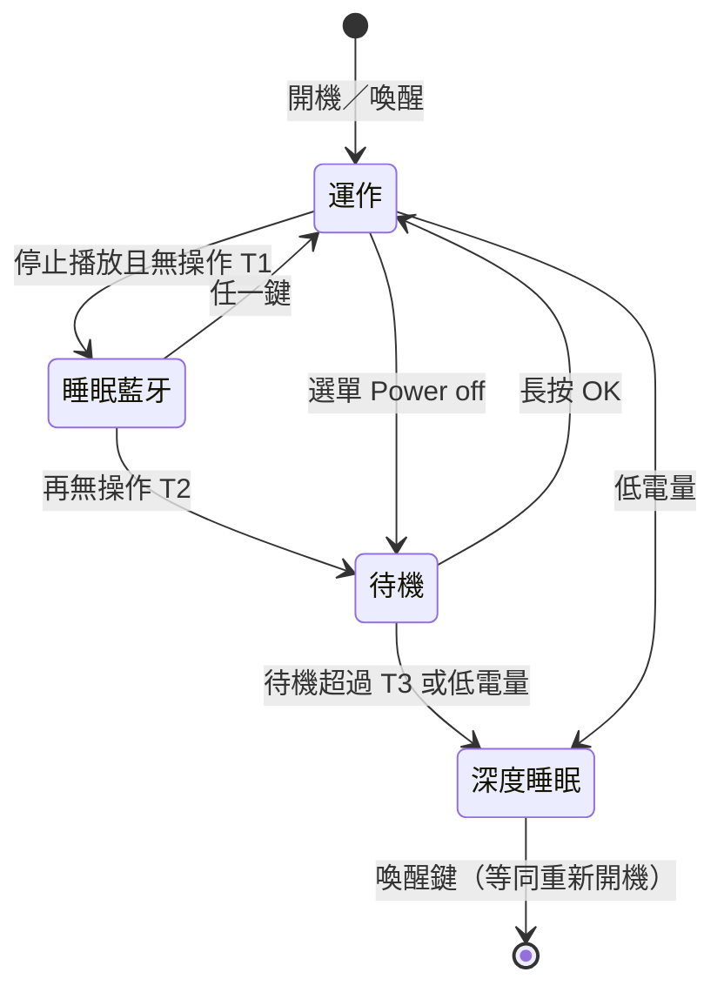
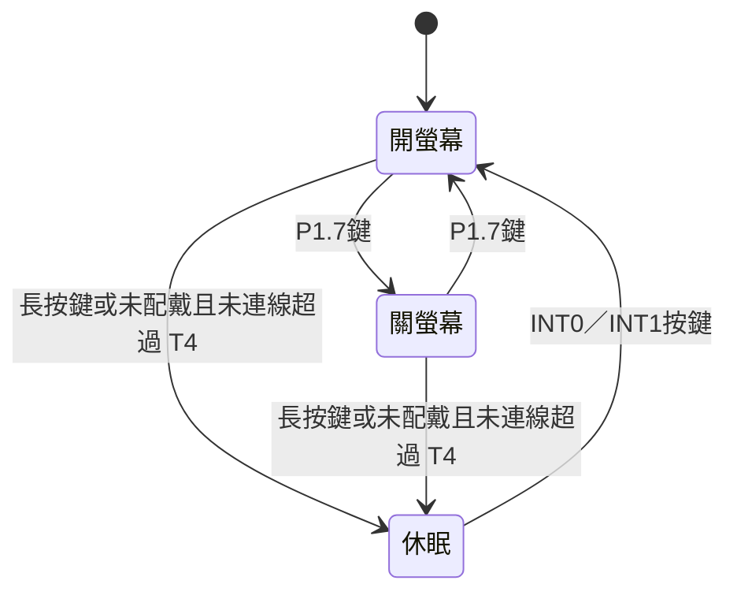

# 功耗模式規劃（HUB與手錶）

> 狀態（2026-10-22）：規劃草案，尚未核定；使用者決定目前不實作功耗模式。依據為作品說明簡報`project/07聽見你的新-作品說明簡報_261021_v2.pptx`第2頁的功耗與續航數據，以及目前原始碼。確認後的規則再整理進`AGENTS.md`第4節；本文不規定實作細節。

## 1. 簡報數據與目前實作

### HUB8735 Ultra（電池5000mAh，量測5V端）

| 簡報狀態 | 簡報續航 | 5V端電流 | 目前實作 |
| --- | --- | --- | --- |
| 持續播放 | 18.3小時 | 160.5mA（實測） | 有：`audioTask`播放 |
| AI辨識 | 17小時 | 171.3mA（實測） | 有：手動BPM／曲風分析 |
| 睡眠(藍牙) | 1.8天 | 約68mA（反推） | **無**：沒有「關螢幕但保留BLE」的狀態 |
| 待機 | 2.1天 | 約58mA（反推） | 有：Power off＝軟體待機（停播放、斷BLE、關本地感測、關OLED，CPU仍執行） |
| 深度睡眠 | 21~31天 | 約4~6mA（反推） | **無**：未使用SDK的`PowerMode`（AmebaPro2 Deep Sleep） |

反推方式：持續播放18.3小時×160.5mA≈2.94Ah（5V端可用電量，含升壓損耗），再除以各狀態的續航時間。只有前兩列是量測值，其餘需實測確認。

### 手錶N76E003（電池120mAh，3.3V）

| 簡報狀態 | 簡報續航 | 電流 | 目前實作 |
| --- | --- | --- | --- |
| 開螢幕 | 約5.4小時 | 25.07mA（實測） | 有 |
| 關螢幕 | 約10.3小時 | 13.05mA（實測） | 有：P1.7鍵切換OLED開關，量測與BLE照常 |
| 休眠 | 約1週（依規格推估） | 平均需低於約0.7mA | **無**：MCU、BM7701、PPG模組、IMU都沒有進入低功耗的流程 |

結論：簡報列出的「HUB睡眠(藍牙)」、「HUB深度睡眠」、「手錶休眠」三種狀態目前都沒有實作，續航數字也不是實測值。在實作並實測之前，簡報應註明這些數字是推估值。

## 2. HUB模式與切換（提案）

| 狀態 | 保留 | 關閉 | 喚醒 |
| --- | --- | --- | --- |
| 運作（播放／分析／閒置） | 全部 | — | — |
| 睡眠(藍牙) | BLE連線、感測與心率分析、設定 | OLED、功放（已停止播放） | 任一鍵；是否也允許感測資料喚醒見待決問題 |
| 待機（現有） | 設定（RAM） | 播放、分析、BLE、本地感測、OLED | 長按OK |
| 深度睡眠 | 只有存到SD／Flash的設定 | 整個SoC（喚醒等同重新開機） | AON GPIO或RTC |

切換規則提案：

- 只有「停止播放、沒有分析進行中」才會自動進入睡眠；播放或暫停中不自動降級，因為暫停也算使用者明確的狀態。
- 從睡眠或待機喚醒後，沿用4.5節規則：保留設定，播放維持停止，由使用者重新選擇。
- 低電量（`UITask`已有`batteryPercent()`）時先提示，再進入深度睡眠，避免鋰電池過放。
- 職責沿用4.5節：`controlTask`持有功耗狀態並決定切換；`UITask`只負責動畫、按鍵與無操作計時回報；`BLETask`／`analysisTask`／`audioTask`依狀態關閉各自的硬體。
- 進入深度睡眠前，音量、模式、感測來源要先寫入非揮發儲存，否則喚醒後會回到預設值。

## 3. 手錶模式與切換（提案）

| 狀態 | MCU | BM7701 | BMH08002-4 PPG | LSM6DS3 | OLED |
| --- | --- | --- | --- | --- | --- |
| 開螢幕 | 執行 | 廣播／連線 | 量測 | 量測 | 開 |
| 關螢幕 | 執行 | 廣播／連線 | 量測 | 量測 | 關（0xAE） |
| 休眠 | Power-down，按鍵外部中斷喚醒 | `API_PowerSaving`進Deep Sleep，喚醒前先送dummy bytes，約30ms後才完全醒來 | 送停止量測命令（`ppg_stop_cmd`）；EN腳目前固定為高、韌體不控制 | Power-down | 關 |

- 「未配戴」可以用PPG `status`（0＝finger off）判斷；HUB斷線本身不應立刻休眠，因為手錶可能只是暫時離開HUB的範圍。
- 三個手錶變體共用`ble_sensor/source/main.c`，休眠流程放在共用程式即可三者一致；`ble_sensor_capture`是測試工具，可以不支援休眠。
- 喚醒後重新廣播，由HUB的Auto連線接回；HUB端Auto失聯後維持Auto持續重試（2026-10-23起），所以手錶醒來後HUB會自動接回。

## 4. 待決問題

1. **硬體能否深度睡眠與斷電**（2026-10-22查證；使用者決定暫不實作功耗模式，簡報續航維持標示為推估）：
   - HUB8735 Ultra的AON喚醒腳是PA_1／PA_2／PA_3＝D28／D9／D10（SDK範例寫的21／22是AMB82-mini的編號）。OK鍵D10＝PA_3，本身就能喚醒深度睡眠。
   - SDK `PowerMode`固定設成「下拉＋上升緣」喚醒，但OK鍵目前接成「上拉＋按下接地」。要用OK鍵喚醒，有三條路：(a) 不改線，繞過函式庫自行設定上拉＋下降緣，但SDK沒有保證可行，需要實機測試；(b) OK鍵改接3.3V、改成高電位有效；(c) 另加一顆喚醒鍵在D28，但PA_1是SWD腳，會失去SWD除錯。
   - 喚醒等同重新開機。若要維持「長按OK才喚醒」，需要開機後檢查OK是否還按著，不夠2秒就再回去睡。
   - 日後要實作時，再從上面三條路擇一，並實測深度睡眠電流。
2. **睡眠(藍牙)的喚醒來源**：只有按鍵，還是手錶送來有效心率也能喚醒（例如使用者開始運動時自動恢復顯示）？後者需要BLE保持連線。
3. **時間門檻**：T1（閒置到睡眠）、T2（睡眠到待機）、T3（待機到深度睡眠）、T4（手錶未配戴到休眠）的數值，以及是否開放使用者在選單設定。
4. **手錶休眠的觸發方式**：只有兩顆鍵且都已有用途（換頁、開關螢幕），休眠要用長按、兩鍵同按，還是只靠自動判斷？
5. **手錶休眠時HUB的連線策略**（2026-10-23已決定）：HUB的Auto連線失聯後維持Auto持續重試，手錶醒來重新廣播即自動接回；使用者在HUB選單Disconnect或切Manual後才不重連。
6. **PPG模組電源**：手錶的BMH08002-4 EN腳目前固定為高，韌體只能送停止量測命令。停止量測後模組的待機電流需要實測；若電流太大，就要改線路讓MCU控制EN，否則休眠無法達到1週續航，簡報數字需要修正。
