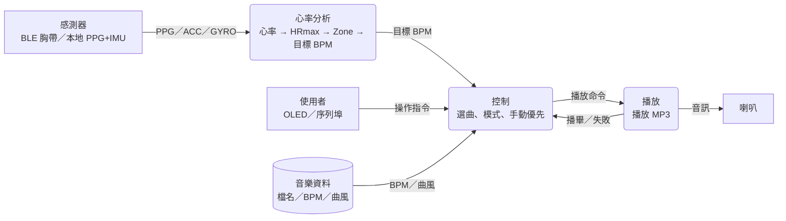
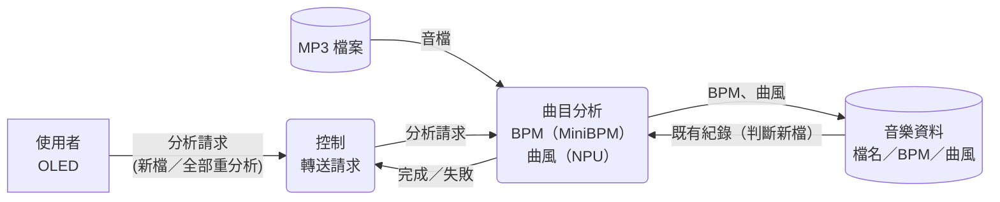
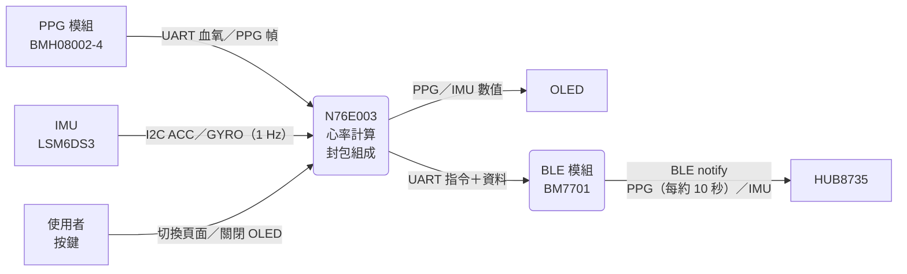
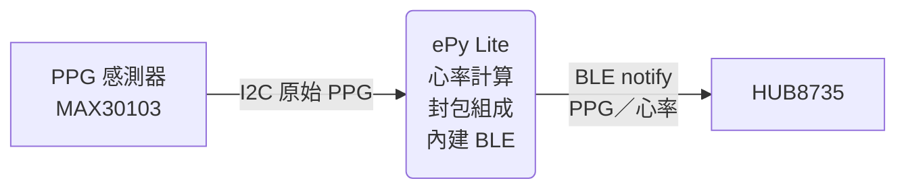

# HUB8735 資料流程圖（概念版）

依目前實作整理，非已核定的架構規則。細節見 `HRMAX_MUSIC_FLOW.md`、`globalData.h`、`firmware/n76e003/ble-notify-data-format.md`。

## 1. 播放音樂

感測器心率 → 目標 BPM → 控制選曲 → 播放；使用者指令可隨時插手（手動優先）。

## 2. BPM／曲風分析

只在使用者啟動時執行，歌曲停止後才開始；單曲失敗不影響其他曲目。

## 3. 感測器端（手錶）

連線流程：重置 BLE 模組 → 設名稱 → 廣播 → 等連線與訂閱 → 持續送資料；斷線後重新廣播。

## 4. 感測器端（綁帶）

單一板子取代 N76E003＋BM7701（見 `docs/ePy_Lite/problems.md`），無 IMU；MAX30103 輸出原始 PPG，心率在板上計算。
