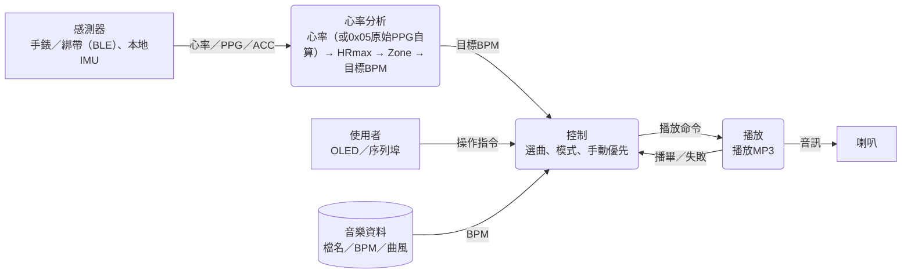
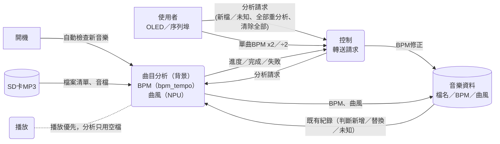
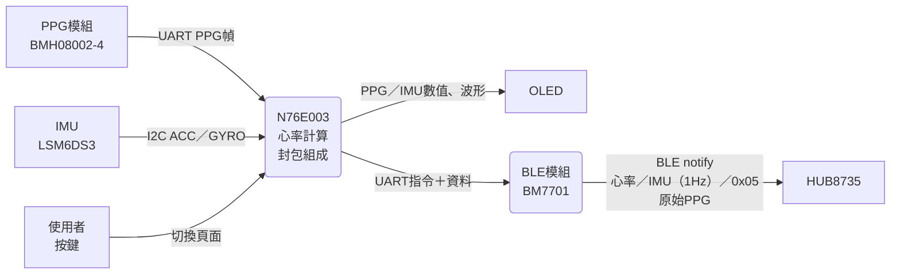
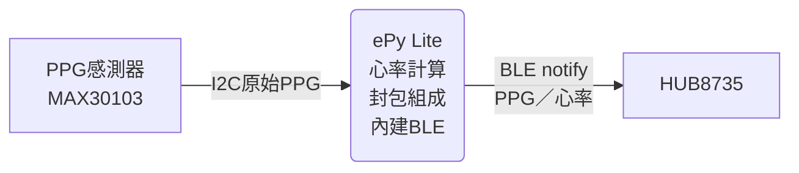

# HUB8735 資料流程圖（概念版）

> 2026-10-26更新：曲目分析改為背景執行，開機自動檢查新音樂，可與播放同時進行；仍可從選單手動要求分析。本文為概念圖，非目前程式的完整資料流，現況見[架構核對](../ARCHITECTURE.md)。綁帶由其他人實作，第4節僅為歷史方案。

細節見`HRMAX_MUSIC_FLOW.md`、`globalData.h`、`firmware/n76e003/ble-notify-data-format.md`。

## 1. 播放音樂

感測器心率 → 目標BPM → 控制選曲 → 播放；使用者指令可隨時插手（手動優先）。背景分析進行中選曲照常，只選已有有效BPM的歌。

## 2. BPM／曲風分析（背景）

- 開機時比對SD與曲庫，新增／替換檔與未知BPM或曲風的歌自動排入背景分析；開機後才放入的檔案要手動分析或重開機。
- 分析可與播放同時進行，播放優先，不得斷音；分析完成的歌立即可參與自動選歌。
- 使用者仍可隨時從選單手動要求「新檔／未知」或「全部重分析」；「清除全部」會先取消進行中的分析。
- 單曲失敗不影響其他曲目。

## 3. 感測器端（手錶）

手錶變體差在心率來源：模組心率（`ble_sensor`）、自算並送0x05（`ble_sensor_hr`）、抗運動自算（`ble_sensor_motion`、`ble_sensor_demo`）。手錶不參與曲目分析。

連線流程：重置BLE模組 → 設名稱 → 廣播 → 等連線與訂閱 → 持續送資料；斷線後重新廣播。

## 4. 感測器端（綁帶，歷史方案）

綁帶由外部實作，本圖僅供參考；本專案只維護HUB接收端。
