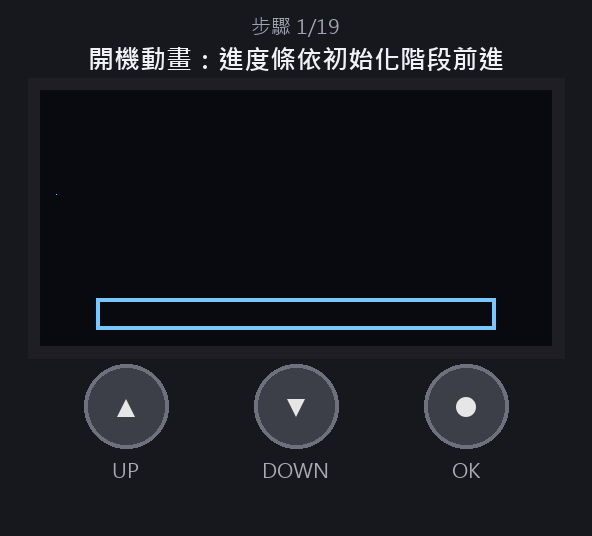

# HUB操作畫面（SH1106 OLED＋3按鈕）

> 依`firmware/hub8735-ultra/application/embedded_loudspeaker/UITask.cpp`的版面與選單邏輯繪製的示意動畫，數值（心率、時間、電量）為假資料。動畫繪於2026-10-27的變更之前：開機模式、暫停行為、Age項目與分析進度頁以下表文字為準。

## 按鈕

| 按鈕 | 腳位 | 一般選單 | 音量條／年齡設定 |
| --- | --- | --- | --- |
| ▲ UP | D8 | 游標上移（到頂循環到底） | 音量 +10%／年齡 +1 |
| ▼ DOWN | D9 | 游標下移（到底循環到頂） | 音量 −10%／年齡 −1 |
| ● OK | D10 | 執行／進入目前項目 | 確定並回主選單（年齡此時才存入Flash） |

待機中只有**長按OK約2秒**可喚醒。

## 畫面結構

1. 第1列：播放狀態（▶播放／❚❚暫停／■停止）、`C`綁帶與`W`手錶連線（實心＝已連線、閃爍＝連線中、空框＝未連線）、分析中沙漏、開機後時間、電量。
2. 第2列：播放中的檔名與曲庫BPM，例如`001.mp3(122)`；停止時顯示`Stopped`。
3. 中間4列：選單，反白為游標，右側`^`／`v`表示上下還有項目。
4. 底部2列（Info bar，可在選單關閉以多顯示2列選單）：心率／SpO2／狀態，加速度與陀螺儀。

## 操作步驟

| 步驟 | 按鈕 | 結果 |
| --- | --- | --- |
| 1 | — | 開機動畫：心電圖掃過→變成愛心→愛心跳動加音符與「Hear your heart」；進度條依實際初始化階段（SD、曲庫、開機掃描、NPU模型、喇叭）前進，至少播3秒 |
| 2 | — | 初始化完成進入主選單，`Mode: Enjoy`；取得有效心率後自動依目標BPM選歌播放（沒有任何歌有BPM時先隨機播一首，分析出BPM後替換） |
| 3 | OK | 進入模式清單：Enjoy／Train／Manual／Demo，`*`為目前模式 |
| 4 | DOWN | 狀態列顯示心率Zone與目標BPM（唯讀；Train模式此列按OK可重新開始課表） |
| 5 | DOWN、OK | 移到`Pause`並暫停；**仍維持原模式**（Enjoy／Train／Demo），暫停中不換歌、課表凍結，感測更新不會自行恢復播放 |
| 6 | OK | 同一列變成`Resume`，再按一次繼續播放；暫停期間若Zone或強度已改變，恢復後才換歌 |
| 7 | DOWN | `Song BPM`（OK可x2／÷2修正） |
| 8 | DOWN、OK | `Stop`：停止並轉為Manual，須在Mode重新選自動模式 |
| 9 | DOWN、OK、UP×2、OK | `Volume`：每按一次UP加10%，OK確定回主選單 |
| 10 | DOWN、OK | `Age: 25`：UP／DOWN調整年齡（6～99，畫面同時顯示HRmax），OK存入HUB內部Flash並立即用於Zone與Train |
| 11 | DOWN×5、OK | 經過BPM Analysis、Source、BLE、Info bar到`Power off`，開啟關機確認，預設停在`Cancel` |
| 12 | DOWN、OK | 選`Power off`：關機動畫後進入軟體待機（停止播放、取消BPM分析、本機感測器斷電、BLE斷線、OLED關閉，並清除目標BPM） |
| 13 | 長按OK約2秒 | 喚醒：播開機動畫，保留音量、年齡與感測來源，回到Enjoy並等新的有效心率 |

## 其他主選單項目

- `Songs`（僅Manual模式）：曲庫清單，選歌後可播放或修正BPM。手動播放會轉為Manual。
- `BPM Analysis`：分析新檔／未知BPM、全部重分析、清除全部結果（需再確認）。分析中進入會顯示進度頁，`Back`回主選單（分析在背景繼續），`Cancel analysis`才取消。
- `Source`：PPG與IMU各自切換Chest／Watch／Local。
- `BLE`：綁帶與手錶的連線／斷線，以及Auto／Manual重連模式。HUB依名稱連第一個找到的裝置，同一空間只使用一套。
- `Info bar`：開關底部感測資訊列。
