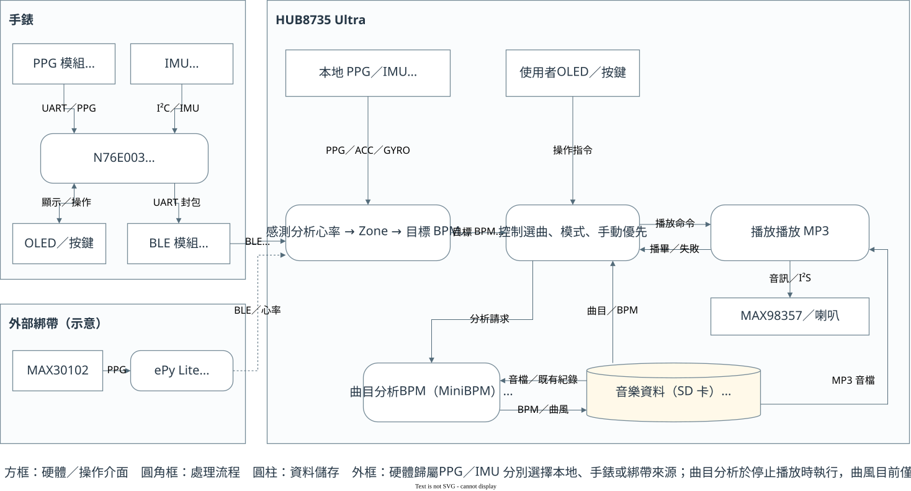

# 作品說明簡報內容草稿

本稿對應範本的「系統架構圖」「軟硬體整合說明」「補充說明」三頁。以下整理簡報內容，其中「感測、通訊與操作」依需求保留完整欄位說明，後方另有技術備查資料。模型版本仍待確認，以共同訓練流程描述。

## 簡報第 4/9 頁：系統架構圖



[可編輯架構圖](./system_architecture.drawio)（第一頁依 DFD.md 的資料流程畫法呈現整體架構，第二頁保留韌體任務資料流作備查）

**圖下補充文字：** 手錶由 N76E003 計算心率，經 BM7701 傳送至 HUB。HUB 整合三種感測來源，依 Enjoy 即時心率或 Train 課表選曲，透過 SD 音檔與音訊模組播放。

## 簡報第 5/9 頁：軟硬體整合說明

### 感測、通訊與操作

#### 1. 感測來源與硬體連接

系統提供手錶、外部綁帶與 HUB 本地三種感測來源。使用者可分別指定 PPG 與 IMU 的來源，HUB 依選擇接收對應資料，送入心率與運動分析流程。

| 來源     | 硬體與介面                                                                           | 提供的資料與處理方式                                                                                         |
| -------- | ------------------------------------------------------------------------------------ | ------------------------------------------------------------------------------------------------------------ |
| 手錶     | BMH08002-4 經 UART 接 N76E003；LSM6DS3 經 I²C 接 N76E003；N76E003 經 UART 接 BM7701 | N76E003 讀取兩路 PPG 並自行計算心率，組成 PPG 封包；六軸感測資料組成 IMU 封包，由 BM7701 透過 BLE 傳給 HUB。 |
| HUB 本地 | BMH08002-4 經 UART、LSM6DS3 經 I²C 直接接 HUB                                       | PPG 使用模組提供的心率與量測值；本地 IMU 以 12.5 Hz 讀取。資料直接進入 HUB 分析流程，不經 BLE。              |
| 外部綁帶 | 以 ePy Lite＋MAX30102 作硬體示意，透過 BLE 接 HUB                                    | HUB 保留外部感測來源的接收介面；此處不展開綁帶韌體，也不假定它具備 IMU。                                     |

手錶與 HUB 的 BMH08002-4 UART 均使用 38400 baud、8N1。BM7701 的 UART 採名義 115200 baud，手錶韌體包含 MCU 時鐘校正，以配合實際通訊。LSM6DS3 與 OLED 使用 I²C，按鍵使用 GPIO。

#### 2. BLE 連線與資料傳送

手錶為 BLE Peripheral／GATT Server，HUB 為 Central／GATT Client。HUB 掃描裝置、建立連線、探索 GATT 服務，並在通知特徵的 CCCD 寫入啟用值後，接收手錶主動上傳的資料。一次 Notify 傳送一筆完整感測封包。

| GATT 項目    | UUID               | 方向與用途                                                               |
| ------------ | ------------------ | ------------------------------------------------------------------------ |
| 感測服務     | `FFF0`           | 手錶提供感測資料服務。                                                   |
| 資料通知特徵 | `FFF1`           | 手錶 → HUB，傳送 PPG 與 IMU 封包。                                      |
| 通知設定     | `0x2902`（CCCD） | HUB 寫入 `0x0001` 啟用 Notify。                                        |
| 寫入特徵     | `FFF2`           | 保留 HUB → 手錶的寫入介面；完整下傳控制協定尚未整合，不列為已完成功能。 |

HUB 另可探索外部來源的服務 `524CACC0-3C17-D293-8E48-14FE2E4DA212`、通知特徵 `D002` 與寫入特徵 `D001`。兩組服務分別探索，不視為 UUID 別名。

#### 3. 共通資料格式

PPG 與 IMU 使用相同的 9-byte 表頭，再接上各自的感測內容。以下位移皆由整個 BLE 封包的第 0 byte 起算，多位元組資料統一採 **Big-endian（高位元組在前）**。封包本身不另加長度或應用層 CRC 欄位，長度由 BLE 通知介面提供。

```text
時間戳記 4 bytes │ 來源／類型 1 byte │ 資料序號 4 bytes │ 感測內容
```

| Byte 位移 | 欄位               | 型別／長度      | 說明                                                                              |
| --------- | ------------------ | --------------- | --------------------------------------------------------------------------------- |
| 0–3      | `sensor_time_ms` | uint32／4 bytes | 感測端毫秒時間戳記，用來標示資料時序。與 HUB 時鐘獨立，不能直接相減當作傳輸延遲。 |
| 4         | `msgType`        | uint8／1 byte   | 高 4 bits 表示感測來源，低 4 bits 表示資料類型。                                  |
| 5–8      | `sequence`       | uint32／4 bytes | 資料序號，PPG 與 IMU 分別計數，協助追蹤資料順序。                                 |
| 9 起      | 感測內容           | 依類型決定      | PPG 為 11 bytes，合併 IMU 為 12 bytes。                                           |

來源碼：`0` 為外部綁帶，`1` 為手錶。本地來源在 HUB 內部編號為 `2`，但不放入 BLE 封包。

| 低 4 bits 類型碼 | 意義             | 手錶完整 `msgType`      | 封包總長 | 目前用途                                 |
| ---------------- | ---------------- | ------------------------- | -------- | ---------------------------------------- |
| `0x01`         | PPG／心率        | `0x11`                  | 20 bytes | 手錶實際傳送。                           |
| `0x02`         | ACC＋GYRO        | `0x12`                  | 21 bytes | 手錶實際傳送，同一次量測的六軸資料合併。 |
| `0x03`         | 僅 ACC           | 若來源為手錶則為 `0x13` | 15 bytes | HUB 可解析，目前手錶不使用此獨立格式。   |
| `0x04`         | 僅 GYRO          | 若來源為手錶則為 `0x14` | 15 bytes | HUB 可解析，目前手錶不使用此獨立格式。   |
| `0x00`         | 控制回應保留類型 | —                        | 未定義   | HUB 目前忽略，不作為完整控制協定描述。   |

#### 4. PPG／心率封包（20 bytes）

手錶在約 10 秒的心率分析週期完成後傳送一筆 PPG 封包，將 N76E003 計算的心率寫入心率欄位，其餘感測欄位取當時最新的模組資料。首週期為暖機，心率輸出 0。這種通知包含摘要與最新 PPG 值，並非連續傳回全部原始波形。

| Byte 位移 | 欄位                | 型別／長度      | 資料內容與用途                                                                |
| --------- | ------------------- | --------------- | ----------------------------------------------------------------------------- |
| 0–3      | `sensor_time_ms`  | uint32／4 bytes | 此筆資料的感測端時間戳記，單位 ms。                                           |
| 4         | `msgType`         | uint8／1 byte   | 手錶 PPG 封包固定為 `0x11`。                                                |
| 5–8      | `sequence`        | uint32／4 bytes | PPG 資料序號。手錶隨有效模組幀遞增，因通知間隔較長，跳號不必然代表 BLE 丟包。 |
| 9         | `status`          | uint8／1 byte   | `0`＝未接觸，`1`＝接觸中，`2`＝取得資料。                               |
| 10        | `SpO2`            | uint8／1 byte   | 模組提供的血氧欄位，單位 %。                                                  |
| 11        | `heartRateBpm`    | uint8／1 byte   | N76E003 自行計算的心率，單位次／分鐘；`0` 表示無有效心率。                  |
| 12        | `bpi`             | uint8／1 byte   | 模組血流灌注指數欄位，原值保留。                                              |
| 13        | `hrv`             | uint8／1 byte   | 模組心率變異欄位，原值保留。                                                  |
| 14        | `pulseAmplitude`  | uint8／1 byte   | 模組脈搏振幅欄位，原值保留。                                                  |
| 15        | `systoleDuration` | uint8／1 byte   | 模組收縮期時間欄位，原值保留。                                                |
| 16–17    | `ppg1`            | uint16／2 bytes | 第一通道 PPG 原始數值，高位元組在前。                                         |
| 18–19    | `ppg2`            | uint16／2 bytes | 第二通道 PPG 原始數值，高位元組在前。                                         |

`bpi`、`hrv`、振幅與收縮期時間在目前通訊程式中直接保留模組原值，本稿不推定其比例係數或額外單位，也不把它們列為 N76E003 自行推算的結果。Enjoy 選曲採用有效心率；其餘欄位不作為 Enjoy／Train 選曲依據。

#### 5. IMU 合併封包（21 bytes）

手錶每秒讀取並上報一次 IMU，將同一次量測的三軸加速度與三軸角速度放在同一封包，共用時間戳記與序號。

| Byte 位移 | 欄位               | 型別／長度      | 資料內容與用途                      |
| --------- | ------------------ | --------------- | ----------------------------------- |
| 0–3      | `sensor_time_ms` | uint32／4 bytes | IMU 資料的感測端時間戳記，單位 ms。 |
| 4         | `msgType`        | uint8／1 byte   | 手錶合併 IMU 封包固定為 `0x12`。  |
| 5–8      | `sequence`       | uint32／4 bytes | IMU 資料序號。                      |
| 9–10     | `acc_x`          | int16／2 bytes  | X 軸加速度原始 counts。             |
| 11–12    | `acc_y`          | int16／2 bytes  | Y 軸加速度原始 counts。             |
| 13–14    | `acc_z`          | int16／2 bytes  | Z 軸加速度原始 counts。             |
| 15–16    | `gyro_x`         | int16／2 bytes  | X 軸角速度原始 counts。             |
| 17–18    | `gyro_y`         | int16／2 bytes  | Y 軸角速度原始 counts。             |
| 19–20    | `gyro_z`         | int16／2 bytes  | Z 軸角速度原始 counts。             |

各軸使用有號 16-bit 數值，保留正負方向。目前量程為加速度 ±8 g、角速度 ±1000 dps，換算方式為：

- 加速度 `mg = 原始值 × 0.244`。
- 角速度 `mdps = 原始值 × 35`，等同 `°/s = 原始值 × 0.035`。

例如加速度原始值為 1000 counts，對應 244 mg；此例僅說明格式換算，不是實測結果。21-byte IMU 通知要求 ATT MTU 至少 24，預設 MTU 23 的 20-byte 資料空間不足以容納。

#### 6. HUB 接收與操作流程

HUB 收到資料時記錄自己的接收時間 `hub_rx_time_ms`，檢查封包長度、來源碼與資料類型，再依使用者選擇的來源處理 PPG／IMU。`hub_rx_time_ms` 僅存在 HUB 內部，不佔無線封包欄位。心率有效條件為 `status=2`、心率非零，且距接收時間不超過 15 秒。

HUB 透過 SH1106 OLED 顯示感測值、BLE 狀態、播放曲目及課表進度，使用者透過上／下／OK 按鍵設定模式、來源與播放操作。手錶 OLED 顯示自身量測與連線狀態，按鍵控制顯示頁面。手動播放、暫停或停止優先於自動選曲。

BLE Auto 模式在尚未連上時重試，已連線後失聯則轉為 Manual，等待使用者重新連線或啟用 Auto。Enjoy 尚未取得有效心率時等待；取得有效目標後失聯，沿用最後有效目標 BPM，但不自行解除暫停或停止。Train 依課表進度選曲，實際心率只供顯示。

### 分析、選曲與播放

- **Enjoy：** 依有效心率判定 Zone。Z1 對應較慢節奏，Z2–3 以心率作目標 BPM，Z4–5 以心率的 0.75 倍作目標，加入遲滯與持續時間避免頻繁切換。
- **Train：** 依 Z2、Z4、Z2、Z5、Z1 課表，取 Zone 中點心率作目標 BPM。提供 11 分鐘與 5 分鐘版，到時換段選曲，實際心率僅供顯示。
- **音樂分析：** MiniBPM 估計節奏。自訓 YAMNet 以 log-mel 頻譜作曲風分類；HUB 現行程式使用 SDK YAMNet，自訓版本部署待確認。
- **輸出：** 曲庫 JSON 儲存檔名、BPM 與曲風。HUB 目前依 BPM 選歌，解碼 SD 音檔後經 I²S、MAX98357 與喇叭播放。手動操作優先。

## 簡報第 9/9 頁：補充說明（選填）

| 項目               | 內容                                                   |
| ------------------ | ------------------------------------------------------ |
| 企業需求／應用場域 | 【保留欄位】                                           |
| 後續發展           | 【待確認】可考慮自訓模型部署、曲風偏好與自動音檔分析。 |
| 風險與效益         | 【保留欄位】                                           |
| 跨領域分工         | 【保留欄位】                                           |
| 專案管理／風險管控 | 【保留欄位】                                           |
| 其他成果           | 【保留欄位】                                           |

---

## 編排備註（不貼入簡報）

- 範本為 16:9，總上限十頁。第 4/9 頁以一張橫向架構圖為主，圖下只留一段說明。
- 整體架構圖以軟體功能命名，保留硬體邊界、通訊方式與資料路徑；FreeRTOS 任務名稱只留在技術備查。
- 「感測、通訊與操作」先完整列出來源、連線流程與各封包欄位，實際排入第 5/9 頁時再依可用空間編排；不以原先雙欄短摘要限制本節資訊。
- BLE 完整 byte 位移、型別與用途已放入主文。模型實驗表與其他演算法參數另保留備查；Markdown 詳細稿不代表所有內容可直接塞入同一張投影片。
- 模型測試數字若日後採用，適合放範本第 2/9 頁「作品實測數據」，並註明為離線模型測試及方法，不能當作 HUB 實機測試。
- 圖中不放校徽、姓名、單位或可辨識連結。補充頁沿用範本深藍標題帶，未確認的成果維持留白。

---

# 技術備查：系統架構與軟硬體整合說明

> 整理日期：2026-10-18。本文件以 HUB8735 Ultra 與 N76E003 手錶為主要範圍；綁帶僅作外部輸入示意。依目前程式與訓練紀錄描述，實機成果另保留欄位。自訓模型的正式採用版本尚待確認。

## 1. 系統架構圖


[可編輯 draw.io 原始圖](./system_architecture.drawio)

系統以 HUB8735 Ultra 作為感測資料整合、音樂分析與播放中心。感測輸入分為手錶、外部綁帶與 HUB 本地三種來源；PPG 與 IMU 可分別選擇來源。圖中外框表示硬體歸屬，框內的軟體流程表示該硬體執行的工作，箭頭標示感測資料、操作指令與音訊的方向。

手錶由 N76E003 讀取 BMH08002-4 的 PPG 訊號並自行計算心率，同時讀取 LSM6DS3 的加速度與角速度，再經 BM7701 傳送至 HUB。HUB 本地感測器直接透過 UART／I²C 接入。外部綁帶依指定以 MAX30102 與 ePy Lite 簡畫，其內部韌體不在本文件展開，也不假定它提供 IMU。

HUB 收到感測資料後，Enjoy 依有效心率產生目標歌曲 BPM；Train 依課表段落產生目標歌曲 BPM。控制模組從曲庫挑選歌曲，交由播放模組讀取 SD 卡、解碼並經 MAX98357 驅動喇叭。使用者透過 OLED 與按鍵選擇模式、感測來源與播放操作。

歌曲分析是另一條資料流程：停止播放時，由使用者啟動掃描，依序計算 MiniBPM 節奏與 YAMNet 曲風，將結果寫入曲庫。目前自動選曲依據為歌曲 BPM，曲風結果先儲存，尚未參與選曲。

## 2. 軟硬體整合說明

### 2.1 硬體模組與感測元件

| 所屬裝置     | 模組／元件                   | 功能與整合方式                                                                                                   |
| ------------ | ---------------------------- | ---------------------------------------------------------------------------------------------------------------- |
| HUB          | HUB8735 Ultra                | 系統主控平台，執行 FreeRTOS 任務、BLE 接收、感測分析、曲庫管理與音樂播放；NPU 用於曲風推論。                     |
| HUB          | BMH08002-4                   | 本地光學脈搏／血氧模組，透過 UART 提供 PPG 與模組計算結果；此路徑使用模組心率，不套用手錶的自行計算流程。        |
| HUB          | LSM6DS3                      | 三軸加速度計與三軸陀螺儀，透過 I²C 讀取，提供運動資料；本地以 12.5 Hz 連續讀取。                                |
| HUB          | SD 卡                        | 儲存 MP3、Demo 音檔與 `music_library.json`，由音訊任務統一存取。                                               |
| HUB          | MAX98357 與喇叭              | 接收 HUB 的 I²S 數位音訊並放大，輸出可聽見的音樂。                                                              |
| HUB          | SH1106 OLED、上／下／OK 按鍵 | OLED 透過 I²C 顯示選單與狀態；按鍵透過 GPIO 提供操作。                                                          |
| 手錶         | N76E003                      | 穿戴端 MCU，執行 PPG 心率計算、IMU 讀取、封包組成、BLE 模組控制與顯示操作。                                      |
| 手錶         | BMH08002-4                   | 提供兩路 PPG 資料，透過 UART 送入 N76E003；本文件以 N76E003 自行分析心率的 `ble_sensor_hr` 為主。              |
| 手錶         | LSM6DS3                      | 透過 I²C 提供加速度與角速度，手錶每秒讀取並上報一次合併 IMU 封包。感測器設定的輸出頻率與 BLE 上報頻率分開描述。 |
| 手錶         | BM7701                       | BLE 傳輸模組，透過 UART 與 N76E003 溝通，負責廣播、連線及感測資料通知。                                          |
| 手錶         | SH1106 OLED 與按鍵           | 顯示心率、感測資料及連線狀態，並提供頁面切換與顯示控制。                                                         |
| 外部輸入示意 | ePy Lite＋MAX30102           | 僅用於圖示外部綁帶的光學感測與 BLE 資料來源；不展開其硬體、演算法或驗收狀態。                                    |

### 2.2 韌體分工與資料路徑

手錶採事件與輪詢流程處理感測資料：UART 接收 PPG 模組資料並驗證幀，主流程執行心率分析與 IMU 讀取，封裝後送交 BM7701。HUB 以 FreeRTOS Queue 串接任務，使 BLE 接收、感測分析、控制、音訊與畫面更新分工。

| HUB 任務         | 主要責任                                         | 輸入與輸出                                                      |
| ---------------- | ------------------------------------------------ | --------------------------------------------------------------- |
| `BLETask`      | 管理手錶／外部來源連線、解析通知並依所選來源篩選 | BLE frame → PPG／ACC／GYRO Queue；連線與感測狀態 → UI。       |
| `analysisTask` | 讀取本地感測器，處理有效心率、Zone 與運動強度    | 選定的感測資料 → 目標 BPM／Demo 強度 → 控制任務。             |
| `controlTask`  | 持有模式、課表計時、選曲、手動優先及待機狀態     | 目標 BPM、操作指令、播放事件 → 播放或分析命令。                |
| `audioTask`    | 統一處理 SD、曲庫載入、MP3 播放與歌曲分析        | 播放命令 → I²S 音訊；播畢／失敗 → 控制任務；分析進度 → UI。 |
| `UITask`       | OLED 選單、按鍵與狀態呈現                        | 使用者操作 → 控制任務或 BLE 任務；其他任務狀態 → OLED。       |

本地與遠端感測資料進入相同分析流程。PPG、IMU 各自選一個來源，並非將三個來源混成同一組量測。選本地來源時，對應類別的 BLE 資料不參與分析。

### 2.3 通訊協定與 BLE 資料規劃

硬體內部以 UART 傳送 PPG 模組資料與 BM7701 命令，以 I²C 讀取 LSM6DS3／操作 OLED，以 GPIO 讀取按鍵，以 I²S 輸出音訊。手錶的 PPG UART 設為 38400 baud、8N1；BM7701 使用名義 115200 baud，韌體包含時鐘校正設定以配合實際通訊。

BLE 中，手錶為 Peripheral／GATT Server，HUB 為 Central／GATT Client。HUB 掃描目標、建立連線、探索服務並啟用 CCCD 通知後接收資料。手錶斷線後重新廣播；HUB 的 Auto 模式在尚未連上時重試，已連線後失聯則轉為 Manual，等待使用者重新連線或啟用 Auto。

| GATT 項目             | 手錶使用的 UUID | 功能                                               |
| --------------------- | --------------- | -------------------------------------------------- |
| Service               | `FFF0`        | 感測資料服務。                                     |
| Notify characteristic | `FFF1`        | 手錶 → HUB，一次通知包含一筆感測 frame。          |
| Write characteristic  | `FFF2`        | 保留寫入介面；不將完整感測控制下傳列為已完成功能。 |

HUB 另支援探索服務 `524CACC0-3C17-D293-8E48-14FE2E4DA212`、通知 `D002` 與寫入 `D001`，作為外部來源的相容介面。兩組 UUID 分開探索，不視為相同 UUID 的別名。

**共通封包表頭**（以下偏移均從整個 BLE frame 的第 0 byte 起算）：

| Byte 偏移 | 長度    | 欄位               | 意義                                                                                                         |
| --------- | ------- | ------------------ | ------------------------------------------------------------------------------------------------------------ |
| 0–3      | 4 bytes | `sensor_time_ms` | 感測端時間戳，單位毫秒。                                                                                     |
| 4         | 1 byte  | `msgType`        | 高 4 bits 為來源：0＝外部綁帶、1＝手錶；低 4 bits 為資料類型。                                               |
| 5–8      | 4 bytes | `sequence`       | 資料序號，協助觀察資料間隔；手錶 PPG 序號隨有效模組幀遞增，通知約每 10 秒一次，因此跳號不必然代表 BLE 丟包。 |
| 9 起      | 依類型  | 感測內容           | PPG 或 IMU 欄位。                                                                                            |

所有多位元組欄位採 Big-endian。HUB 另外記錄自己的接收時間，供資料新鮮度判斷；兩端時鐘獨立，不能直接相減當作傳輸延遲。本地來源在系統中編號為 2，但不經 BLE 傳送。

**PPG 封包：手錶類型 `0x11`，總長 20 bytes。**

| Byte 偏移 | 欄位                                                      | 型別／用途                                                                       |
| --------- | --------------------------------------------------------- | -------------------------------------------------------------------------------- |
| 9         | `status`                                                | uint8；0＝未接觸、1＝接觸中、2＝取得資料。                                       |
| 10        | `SpO2`                                                  | uint8；模組提供的血氧欄位。                                                      |
| 11        | `heartRateBpm`                                          | uint8；由 N76E003 計算的心率，0 表示無有效心率。                                 |
| 12–15    | `bpi`、`hrv`、`pulseAmplitude`、`systoleDuration` | 各 uint8；保留模組資料，不表示皆由手錶自行分析，也不作為 Enjoy／Train 選曲依據。 |
| 16–17    | `ppg1`                                                  | uint16，第一路 PPG。                                                             |
| 18–19    | `ppg2`                                                  | uint16，第二路 PPG。                                                             |

PPG 通知在約 10 秒心率計算週期完成後送出，包含當時最新模組資料及計算心率；它不是完整原始 PPG 串流。首週期為暖機，心率為 0。

**IMU 合併封包：手錶類型 `0x12`，總長 21 bytes，每秒上報。**

| Byte 偏移 | 欄位                               | 型別／用途                      |
| --------- | ---------------------------------- | ------------------------------- |
| 9–14     | `acc_x`、`acc_y`、`acc_z`    | int16 × 3，加速度原始 counts。 |
| 15–20    | `gyro_x`、`gyro_y`、`gyro_z` | int16 × 3，角速度原始 counts。 |

目前量程為 ±8 g／±1000 dps，分別以 0.244 mg/LSB、35 mdps/LSB 換算。21-byte 通知需要 ATT MTU 至少 24；端到端相容性列入整合測試。協定另支援分開的 ACC／GYRO 類型 `0x03`／`0x04`（各 15 bytes，不含來源位元），目前手錶主要使用合併封包。

### 2.4 手錶心率演算法

N76E003 對 BMH08002-4 的兩路 PPG 分別處理，採整數串流運算降低記憶體需求。流程為基線移除、平滑、短／長時間平均與動態門檻判斷，找出脈搏區段的峰值，再由峰值間隔換算心率。

每 10 秒整理一次脈搏間隔：保留 300–2000 ms 的間隔，使用中位數排除偏差超過 20% 的值；保留數量與比例足夠時，以平均間隔計算 `心率 = 60000 / 平均間隔毫秒數`。兩路心率需在約 10% 內一致，否則輸出 0。首個週期僅暖機，無有效訊號時也不產生可用心率。這是專案的量測品質篩選流程，不將其描述為已驗證的醫療級準確度。

### 2.5 AI 模型：YAMNet 曲風分類

#### 已有的離線訓練流程

專案在 `tools/yamnet_genre` 保存 YAMNet 遷移學習與微調程式、模型權重、匯出檔及評估紀錄。訓練流程由既有 YAMNet 權重開始，將音訊轉為 16 kHz 單聲道，計算 log-mel 頻譜，使用 96 × 64 的頻譜片段作為模型輸入。模型從 YAMNet 取得音訊特徵，接上專案曲風分類用的 softmax 分類頭。

訓練先凍結骨幹、訓練分類頭，再微調指定的後段區塊；Batch Normalization 維持凍結。資料抽樣先均勻抽取類別，再抽取曲目，以減少類別數量不均的影響；訓練資料加入增益擾動、時間遮罩與頻帶遮罩。評估時將同一曲目的多個視窗分數取平均，形成曲目分類。

資料管線使用 FMA metadata 的 training／validation／test 分割。專案保存多組類別配置與實驗，正式報告採用哪一版仍待確認。以現存 `c5u11` 紀錄為例：

| 項目                 | `c5u11` 訓練紀錄                                                                                           |
| -------------------- | ------------------------------------------------------------------------------------------------------------ |
| 類別                 | Classical、Electronic、Hip-Hop、Rock、Other。Other 合併其餘指定曲風，與「低信心而拒絕分類」的 Unknown 不同。 |
| 資料來源／數量       | FMA medium 管線；訓練 19,906、驗證 2,504、測試 2,572 首。                                                    |
| 30 秒片段曲目分類    | 驗證準確率 78.0%；測試準確率 76.2%。                                                                         |
| 前 15 秒片段曲目分類 | 驗證準確率 77.8%；測試準確率 75.1%。                                                                         |
| 匯出成果             | 五類權重與 `yamnet_c5u11_tf214.h5`／ZIP；匯出程式用於產生供轉換的 H5。                                     |

上述數字為既有離線評估 log，本次未重跑訓練；不代表 NPU 轉換後或 HUB 實機的準確率。信心門檻實驗同時影響分類覆蓋率與正確率，不以「只挑高信心樣本」的結果代替整體測試準確率。

#### HUB 的現行整合

目前 `MusicGenreClassifier` 選擇 SDK 的 `DEFAULT_YAMNET`，將 MP3 解碼、轉為 16 kHz 單聲道 PCM，送入 SDK 音訊分類管線，由 NPU 推論並累積曲風類別分數，最後將曲風寫入曲庫。分析以約 15 秒音訊為目標，長檔會從估算的中段位置開始取樣。

目前原始碼仍使用 SDK 原版的曲風類別索引，不能直接視為自訓五類模型已接入；五類模型的轉換、輸出對應與實機驗證尚待確認。架構圖因此呈現現行 SDK 推論流程，自訓成果在本節獨立說明。

### 2.6 音樂節奏分析與曲庫資料

MiniBPM 從解碼後音訊估計歌曲節奏 BPM；YAMNet 負責曲風分類，兩者用途不同。使用者可選擇「新檔／未知 BPM」或「全部重分析」。分析依曲目逐首進行，單曲失敗不阻擋其他曲目。播放或暫停中不啟動分析；分析中收到播放命令則取消分析。

曲庫採 JSON 儲存，例如以下僅為格式示意，不是實測歌曲：

```json
{
  "version": 2,
  "songs": [
    {"file": "sample.mp3", "bpm": 120, "genre": "Rock", "size": 1234567, "modified": 0}
  ]
}
```

`bpm=0` 表示尚無有效節奏結果；`size` 與 `modified` 分別記錄檔案大小與 FAT 修改時間，供手動掃描辨識變更；`modified=0` 表示未知。具有效 BPM 即可加入自動選曲，曲風分析失敗不阻擋。Demo 音檔另放 `/demo/`，不加入一般曲庫與 BPM／曲風分析。

### 2.7 Enjoy 與 Train 的對應方式

兩種模式共用年齡設定，HUB 以 `HRmax = 206.9 − 0.67 × 年齡` 估計最大心率，取整數後進行 Zone 與目標 BPM 計算。心率 BPM 與歌曲 BPM 分別表示脈搏速率及音樂節奏，系統以規則建立兩者的對應。

**Enjoy：依實際心率調整目標歌曲節奏。**

| Zone | 心率相對 HRmax | 未經上升限制前的目標歌曲 BPM                                                    |
| ---- | -------------- | ------------------------------------------------------------------------------- |
| Z1   | 低於 60%       | `min(80, 60 + round(100 × 心率 / (3 × HRmax)))`，讓低強度區間對應較慢節奏。 |
| Z2   | 60% 至低於 70% | 實際心率。                                                                      |
| Z3   | 70% 至低於 80% | 實際心率。                                                                      |
| Z4   | 80% 至低於 90% | `round(心率 × 0.75)`。                                                       |
| Z5   | 90% 以上       | `round(心率 × 0.75)`。                                                       |

有效心率須符合 `status=2`、心率非零，且距 HUB 接收時間不超過 15 秒。Zone 切換使用 2% HRmax 的邊界遲滯及 10 秒持續時間，以降低邊界附近反覆切換。目標每秒更新，上升每次最多 5 BPM，下降則直接採用新目標。這些是目標更新規則，不表示每秒更換歌曲。

啟動或換 Zone 選曲時，優先找目標 BPM ±5% 內的可播放歌曲，沒有則找最接近者；自然播畢時再找符合歌曲，沒有符合者可重播原曲。尚無有效心率時等待並允許手動播放；曾取得有效目標後資料失效，保留最後有效目標，但不解除使用者的暫停或停止。

**Train：依課表進度調整歌曲節奏。**

Train 不需要先取得有效心率。每段依目標 Zone 中點百分比乘上 HRmax，產生固定的歌曲目標 BPM；實際心率僅顯示。Z1–Z5 的中點分別為 55%、65%、75%、85%、95%，不套用 Enjoy 的 Z4–Z5 乘 0.75 規則。

| 段落 | 課表 Zone | 目標 BPM／HRmax | 完整版 11 分鐘 | 展示版 5 分鐘 |
| ---- | --------- | --------------- | -------------- | ------------- |
| 暖身 | Z2        | 65%             | 3 分鐘         | 1 分鐘        |
| 快   | Z4        | 85%             | 2 分鐘         | 1 分鐘        |
| 恢復 | Z2        | 65%             | 2 分鐘         | 1 分鐘        |
| 更快 | Z5        | 95%             | 1 分鐘         | 1 分鐘        |
| 緩和 | Z1        | 55%             | 3 分鐘         | 1 分鐘        |

時間到立即換段並重新選曲，不等待歌曲播畢。手動暫停或停止會凍結課表；重新選擇同一課表時接續，改選其他課表或已完成的課表則從頭開始。課表完成後停止播放，等待使用者下一次操作。

**其他模式。** Manual 提供直接選曲與播放控制，未知 BPM 的歌曲也可手動播放。Demo 將去除重力後的加速度合力整理為五級強度，新等級維持約 0.5 秒後切換指定 Demo 音檔；強度分級是展示用途的啟發式規則，不能等同經驗證的活動辨識分類。

### 2.8 操作介面與異常處理

本系統的前端為 HUB 與手錶的 OLED／按鍵，後端為各 MCU 的韌體任務與資料流程。HUB 提供模式、來源、曲目、音量、分析及 BLE 操作；UI 將命令送交負責任務，再接收心率、曲目、連線、課表及分析進度等狀態更新。手錶主要顯示自身量測及連線狀態。手機測試模擬器可協助整合測試，不列為正式操作前端。

手動播放、暫停與停止優先於自動模式；只有使用者明確恢復自動模式才重新交由自動選曲。無法播放的曲目會被跳過，全部不可用時停止。曲庫寫入採暫存檔與備份換檔。軟體待機會停止播放與分析、停用本地感測、斷開 BLE 並關閉 OLED；長按 OK 喚醒後保留設定，播放仍維持停止。

## 3. 補充說明

### 3.1 對應企業需求／應用場域

【保留欄位，待補充】

### 3.2 後續發展

【保留欄位，待確認採用內容】

可選方向：自訓五類 YAMNet 的模型轉換與裝置整合、使用者曲風偏好、自動發現新增／替換音檔並在適當時機分析。以上列為後續方向，不列為已完成成果。

### 3.3 風險與效益

【保留欄位，待補充】

### 3.4 跨領域組成與合作分工

【保留欄位，待補充】

### 3.5 專案管理／風險管控

【保留欄位，待補充】

### 3.6 實測成果與其他有利說明

【保留欄位，待補充；離線模型評估見 2.5，不能取代實機驗收】

<!-- 編輯參考，提交前可移除。圖中不含校徽、單位名稱、人名或專案識別標誌。
來源：
- firmware/n76e003/application/ble_sensor_hr/source/main.c、ppg_hr.h：手錶心率與封包。
- firmware/hub8735-ultra/application/embedded_loudspeaker/globalData.h、BLETask.cpp、localSensor.cpp、analysisTask.cpp：來源、通訊與心率對應。
- 同目錄 ControlTask.cpp、train_plan.h、song_catalog.h、motion_level.h：模式與選曲。
- 同目錄 audioTask.cpp、music_library.h、music_genre_classifier.cpp、UITask.cpp：音訊、曲庫、SDK YAMNet、介面。
- tools/yamnet_genre/cache_mel.py、finetune.py、export_h5.py、classmaps/c5.json、logs/c5u11.log：訓練流程與版本評估。
- docs/ARCHITECTURE.md：範圍與實作核對；部分模型規劃敘述未反映 tools 中已有的離線訓練成果，模型部分以原始訓練檔與 log 為準。
-->
